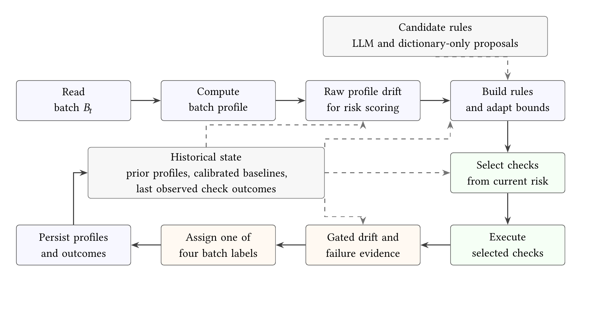

# Adaptive Data Quality Monitoring

Research artifact for **Adaptive and Cost-Aware Data Quality Monitoring for Evolving Data Pipelines**.

**Release:** 0.1.0 · **Frozen protocol:** v2.2 · **Python:** 3.12+ · **License:** [MIT](LICENSE), with [third-party exceptions](THIRD_PARTY_NOTICES.md).

This repository supports the accompanying [research paper](paper/paper.pdf). It contains the monitoring implementation, frozen configuration, saved evaluation evidence, publication figures, and tools for checking that the released results match the reported experiments.

The monitor profiles recurring batches, adapts numerical thresholds, combines drift and failure evidence into four batch labels, admits proposed domain rules after historical screening, tests category-admission guards, and selects checks according to risk.



## Start here

- **Read the study:** [compiled paper](paper/paper.pdf) or [editable LaTeX](paper/latex/main.tex).
- **Verify the supplied evidence:** run the standard-library command below; no data download, AWS account, or model call is required.
- **Replay experiments:** restore the separate research-assets ZIP, then follow [reproduction instructions](docs/REPRODUCIBILITY.md).
- **Locate a reported result:** use the [experiment-to-evidence map](docs/EXPERIMENTS.md).

```bash
python release_tools/verify_release.py
```

Verification checks file integrity, frozen code/configuration fingerprints, author order, and saved metrics. It is an artifact consistency check, not a fresh reproduction of the experiments.

## Repository contents

| Path | Purpose |
|---|---|
| adaptive-data-quality/ | Original research modules, tests, configurations and saved results |
| paper/paper.pdf | Current manuscript, with Selimhan Dagtas as third author |
| paper/latex/ | Complete ACM manuscript source, bibliography, tables and publication figures |
| docs/ | Reproduction, experiment map, data provenance and release instructions |
| environment/ | Original pinned Python 3.14 environment and tested-environment notes |
| release_tools/ | Offline integrity/metric verification and safe asset restoration |
| third_party/ | Required notices and matching ACM template sources |
| CITATION.cff | Machine-readable citation with manuscript author order |
| MANIFEST.sha256 | Integrity hashes for the source release |
| assets_manifest.json | Exact file hashes for the separate large research assets |

## Install and test

Create a virtual environment with Python 3.12 or newer. From the repository root:

```bash
python -m venv .venv
# Activate the environment for your operating system.
python -m pip install -e "./adaptive-data-quality[dev]"
cd adaptive-data-quality
python -m pytest -q
```

The pinned environment used by the recorded experiments is retained in environment/requirements-frozen-py314.txt. A portable installation supports inspection and testing; it is not a claim of bit-for-bit reproduction of the recorded Python 3.14 timings. Optional live LLM calls require the llm extra and credentials, as explained in the reproduction guide.

## Large assets

The companion **adaptive-dq-research-assets-v0.1.0.zip** contains the exact dataset snapshots and cached Deequ/TFDV exchange outputs. These remain outside ordinary Git history. Restore them from the repository root:

```bash
python release_tools/restore_assets.py /path/to/adaptive-dq-research-assets-v0.1.0.zip
```

The restore tool validates the archive against assets_manifest.json and rejects unexpected paths or conflicting files. See [data sources and terms](docs/DATA_SOURCES.md). A new download from the live Chicago portal does not reproduce the frozen snapshot.

## What the results support

- Four-class batch macro-F1 is approximately 0.947–0.966; the gate explains much of the performance.
- Adaptive thresholds help flight-data drift but can absorb persistent corruption. The lower-FPR criterion is not supported on Retail.
- Fixed statistical rules plus admitted LLM rules achieve 0.996–1.00 recall on the selected injected domain-impossible values. This is not the adaptive configuration's result.
- The separate category-guard study contains only 24 distinct novel values.
- Risk-based selection saves approximately 2–11% of checks, with no material total-time benefit after profile reuse in the measured workloads.

The paper states these boundaries, the pending Chicago human adjudication, and the distinction between internal protocol freezing and independent preregistration. Reporting-only corrections to timing units and secondary Holm adjustment are documented in paper/latex/reporting_corrections/ and the reproduction guide. Original frozen pipeline files and configurations are preserved.

## Authors and citation

1. Muzakkiruddin Ahmed Mohammed
2. Ahsan Shahid
3. Selimhan Dagtas
4. John Talburt
5. Abdelrahman Elfikky

University of Arkansas at Little Rock. See [AUTHORS.md](AUTHORS.md) and [CITATION.cff](CITATION.cff). No DOI or public repository URL is invented; add the archival identifiers after the release is published.

## License and contribution

Original project code and accompanying original documentation are released under the [MIT License](LICENSE). Third-party datasets and template files retain their own terms; the repository-wide MIT notice does not replace them. See [THIRD_PARTY_NOTICES.md](THIRD_PARTY_NOTICES.md).

Please read [CONTRIBUTING.md](CONTRIBUTING.md) before changing frozen artifacts. Follow [SECURITY.md](SECURITY.md) for sensitive reports and [the release guide](docs/RELEASING.md) when publishing a version.

## City of Chicago data notice

> This site provides applications using data that has been modified for use from its original source, www.cityofchicago.org, the official website of the City of Chicago. The City of Chicago makes no claims as to the content, accuracy, timeliness, or completeness of any of the data provided at this site. The data provided at this site is subject to change at any time. It is understood that the data provided at this site is being used at one's own risk.
